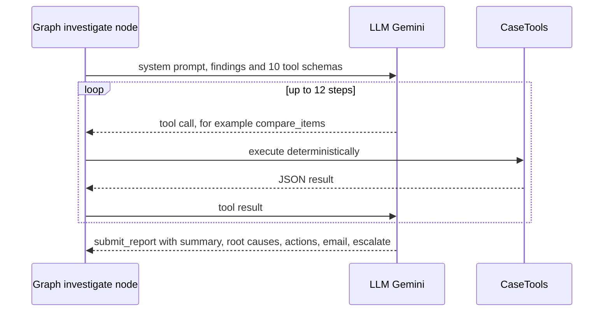

# Architecture

## As-is vs to-be process

| | As-is (manual) | To-be (TradeDocCheck) |
|---|---|---|
| Input | Officer opens 3 PDFs | Officer drops / uploads the PDFs |
| Checking | ~15 facts compared by eye | 15 deterministic checks in under a second |
| Problems | Officer writes the email to the shipper by hand | Investigator agent finds root causes and drafts the email |
| Decision | Officer | System proposes AUTO_PASS / REVIEW / HOLD; **officer confirms** (logged) |

## LangGraph workflow

```mermaid
flowchart LR
    S(["START"]) --> ingest["ingest - pdfplumber"]
    ingest --> classify["classify - ClassifierAgent"]
    classify --> extract["extract - ExtractorAgent rules"]
    extract -->|"fields missing, LLM on, first attempt"| repair["llm_repair - LLM fills only missing fields"]
    extract -->|"complete"| validate["validate - 15 checks, no LLM"]
    repair --> validate
    validate --> decide["decide - severity policy"]
    decide -->|"AUTO_PASS"| report["report - Markdown and JSON"]
    decide -->|"REVIEW or HOLD"| investigate["investigate - LLM tool-calling loop"]
    investigate --> report
    report --> done(["END"])
    done --> human["Officer review in Streamlit"]
```

### State (`graph.CaseState`)

| Key | Written by | Notes |
|---|---|---|
| `raw` | ingest, classify | text + tables per PDF, then doc_type |
| `docs`, `texts` | extract, llm_repair | `ExtractedDoc` per document type |
| `repair_attempts` | llm_repair | caps the self-correction loop |
| `findings` | validate | `Finding(code, severity, expected, actual, suggestion)` |
| `decision` | decide | `AUTO_PASS` / `REVIEW` / `HOLD` |
| `investigation` | investigate | tool steps, root causes, actions, email |
| `summary` | report | |
| `trace`, `path` | every node | reducer `operator.add`, so nodes append instead of overwrite |

The code uses the real `langgraph` package when it is installed. `_minigraph.py` is an 80-line stand-in
with the same API and semantics, used only when `langgraph` is not installed (for example in offline test
environments). The CLI and the UI show which engine ran.

## InvestigatorAgent: the LLM chooses its own tools

| Tool | What it returns |
|---|---|
| `list_documents` | documents present / absent, unreadable fields |
| `get_document` | all extracted fields of one document |
| `list_findings` | validator findings (filterable by severity) |
| `recheck_invoice_line` | qty x price vs amount, shown vs computed totals |
| `compare_items` | one item across invoice and packing list, qty difference, value at stake |
| `compare_parties` | seller/shipper and buyer/consignee names with similarity |
| `compare_quantities` | packages and weights: item sums vs totals vs B/L, diff % |
| `check_dates` | invoice, packing list and on-board dates, chronological order |
| `lookup_hs_code` | digit-count validity, chapter and heading (local reference table) |
| `submit_report` | final structured answer (ends the loop) |

**Guardrails**
- The agent cannot change the decision. It only explains the result and recommends actions.
- Tools are read-only apart from `submit_report`, and an unknown tool name returns an error instead of crashing.
- Hard limit of 12 steps. Every call and its result is logged and shown in the UI.
- The prompt tells the agent to state only numbers that came from tool results.
- If the LLM errors, a rule-based planner calls the same tools in a fixed order, so the output format stays the same.

## Where the LLM is used, and where it is not

| Task | Tool | Reason |
|---|---|---|
| Unusual layouts and labels | LLM (`llm_repair`, classifier fallback) | flexible understanding |
| Comparing numbers, sums, dates | Python | exact, auditable, free |
| Investigating and explaining, drafting emails | LLM + tools | reasoning and language, grounded in tool output |
| Final decision | Officer | accountability |

## Decision policy

- any `HIGH` finding means `HOLD`
- only `MEDIUM`/`LOW` findings mean `REVIEW`
- no findings means `AUTO_PASS`

## LLM back-ends (`llm.py`)

Gemini, Claude and Ollama are all called over REST with `urllib`, so no vendor SDK is needed. Each back-end
implements `complete()` for plain text/JSON and `start()`/`step()`/`add_results()` for tool calling,
which lets the investigator loop stay provider-independent. For Gemini, the model's content (including
thought signatures) is sent back verbatim on each turn, and no `temperature` is sent because recent
Gemini models no longer accept it.

## Evaluation

- `tests/test_pipeline.py`: for every sample case, the set of finding codes equals the planted ground truth.
- `tests/test_agents.py`: graph routing (repair branch, investigate branch), a scripted LLM choosing tools,
  LLM-outage fallback, unknown-tool handling, and request/response formats for Gemini, Claude and Ollama
  (HTTP mocked).
