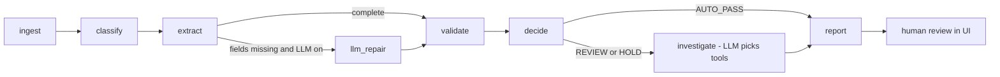

# TradeDocCheck: Agentic Document Intelligence for Import/Export Documents

Agentic AI course project: *Document Intelligence Solution*.

**Domain:** International trade / logistics (customs documentation)
**Team:** _<add group name and members (4-6) here>_
**Video presentation:** _<add YouTube link>_

## 1. The pain point

Before a shipment can be cleared, a trade-documentation officer opens the **Commercial Invoice**,
**Packing List** and **Bill of Lading** and compares the same facts across all three by eye
(party names, quantities, package counts, weights, amounts, dates, invoice references).

- **Slow:** one shipment means dozens of manual comparisons.
- **Error-prone:** a one-digit slip in weight or quantity is easy to miss.
- **Expensive when missed:** customs holds, demurrage, letter-of-credit discrepancies, rejected payments.

## 2. The solution

TradeDocCheck reads the PDF set for a shipment and runs a **LangGraph** workflow of cooperating agents.
It returns a decision (`AUTO_PASS` / `REVIEW` / `HOLD`). For any case that does not pass, an
**autonomous investigator agent** works out root causes and drafts the correction email. The officer
makes the final call in the UI.



| Agent / node | Job | How |
|---|---|---|
| `ClassifierAgent` | Identify the document type | Keyword rules; LLM fallback for unknown layouts |
| `ExtractorAgent` | PDF text/tables to structured fields | Rules first; the **`llm_repair`** node asks the LLM for *only* the fields the rules missed (self-correction) |
| `ValidatorAgent` | 15 cross-document checks | Deterministic Python, so results are auditable and reproducible |
| `InvestigatorAgent` | Root causes, actions, draft email | **Tool-calling loop:** the LLM chooses from 10 tools (`compare_items`, `recheck_invoice_line`, `compare_quantities`, `lookup_hs_code`, ...) and ends with `submit_report` |
| `ReporterAgent` | Decision + report (Markdown / JSON) | Severity rules |
| Human review | Approve / reject / request correction | Streamlit form, logged to `outputs/reviews.jsonl` |

**Design principle:** the LLM helps to *understand* messy documents and to *investigate and explain*
problems. It **never decides pass/fail**: decisions about money, weight and quantity are
deterministic, and every number the investigator states comes from a tool result.
If the LLM is missing or fails, every node has a rule-based path, so the system always produces a result.

### Checks performed (ValidatorAgent)

Missing document, missing field, invoice line arithmetic, invoice total, HS code format,
packing-list package sum, net > gross weight, invoice reference, unmatched items, item quantity,
shipper name, consignee name (fuzzy: spelling variant = LOW, different party = HIGH),
package count, gross weight (0.5% tolerance; > 2% = HIGH), and on-board date vs invoice date.

## 3. Run it

```bash
pip install -r requirements.txt
cp .env.example .env            # Windows: copy .env.example .env   -- then put your Gemini key in it
streamlit run app.py            # web UI (recommended for the demo)
python -m tradedoccheck data/samples --all              # CLI, rule-based
python -m tradedoccheck data/samples --all --llm gemini --lang Thai
pytest                          # 19 tests, no network or API key needed
```

On **Windows cmd** use `python` (not `python3`). If Thai text looks garbled, run `chcp 65001` first.
Set variables with `set GEMINI_API_KEY=...` (PowerShell: `$env:GEMINI_API_KEY="..."`), or just use `.env`.

LLM options (`TRADEDOC_LLM` or the UI sidebar): `gemini` (default model `gemini-3.8-flash`),
`anthropic`, `ollama` (local), `none`. The UI reads `.env` automatically.

## 4. Sample data

All documents in `data/samples/` are **synthetic** (fictional companies, no real data); regenerate them with
`python scripts/generate_samples.py`. Each case plants known errors, `expected.json` holds the ground truth,
and the tests assert that the system finds exactly those errors.

| Case | Planted problems | Rule-based | With LLM |
|---|---|---|---|
| `case_01_clean` | none | AUTO_PASS | AUTO_PASS |
| `case_02_discrepancies` | qty 1000 vs 900, wrong line amount, shipper spelling variant, gross weight +7.4% | HOLD | HOLD + LLM investigation |
| `case_03_missing_bl` | missing B/L, 5-digit HS code, wrong invoice reference | HOLD | HOLD + LLM investigation |
| `case_04_dates_and_parties` | shipped before invoice date, 190 vs 200 packages, different consignee, net > gross | HOLD | HOLD + LLM investigation |
| `case_05_unusual_labels` | correct documents, but the invoice uses "Our Reference" / "Bill To" labels | REVIEW (fields unreadable) | **AUTO_PASS** via `llm_repair` |

Case 05 shows the value of the conditional edge: the rules alone cannot read the fields, while the
LLM repair node recovers them and the shipment passes.

## 5. Project layout

```
app.py                      Streamlit UI (single case, batch, review log, how-it-works)
tradedoccheck/
  graph.py                  LangGraph StateGraph: nodes, conditional edges, state schema
  pipeline.py               Pipeline.process_case() / stream_case(), saving reports
  agents/                   classifier, extractor, validator, investigator, reporter
  tools.py                  tools available to the InvestigatorAgent (+ JSON schemas)
  llm.py                    Gemini / Claude / Ollama back-ends (text + tool calling, REST)
  review.py                 human-in-the-loop decision log
  config.py                 .env loader, default models
  _minigraph.py             fallback engine used only if langgraph is not installed
scripts/generate_samples.py synthetic PDF generator
data/samples/               5 sample shipments + expected.json
tests/                      19 pytest tests (scripted fake LLM, mocked HTTP)
docs/                       architecture.md, video_script.md
```

## 6. Limitations and future work

- Digital (text-based) PDFs only. Scanned documents need OCR (Tesseract or a vision LLM) before extraction.
- The HS-code reference table is a small demo subset; production would query the national customs tariff.
- The live Gemini/Claude calls are covered only by mocked tests; quality depends on the model.
- Future work: OCR, more document types (Certificate of Origin, customs declaration), checking against
  L/C terms, and using officer feedback from `reviews.jsonl` to improve extraction rules.

## 7. Security

Do not commit `.env` or paste API keys into code or slides. `.env` is already listed in `.gitignore`.
